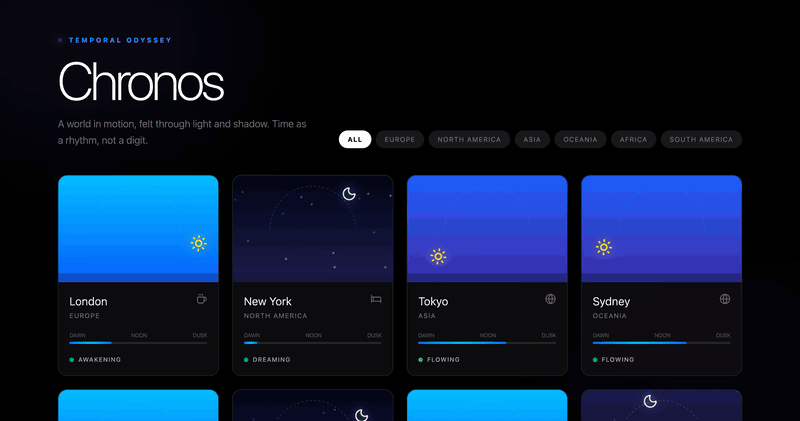
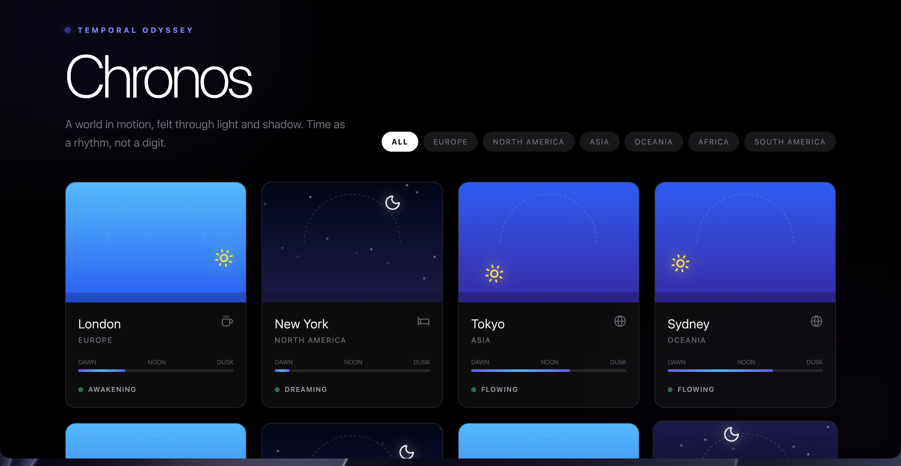
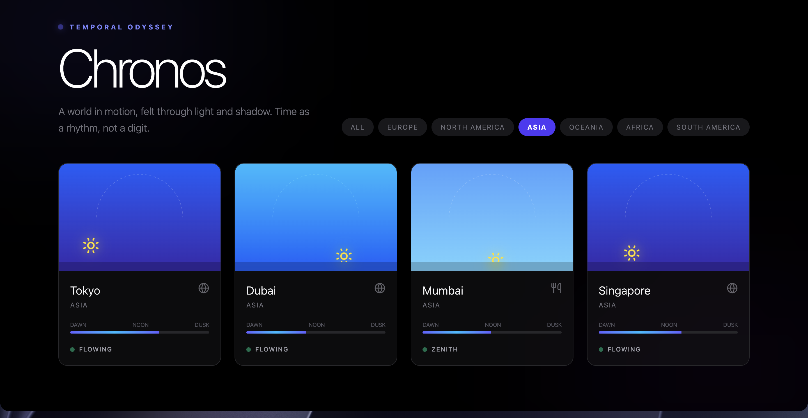
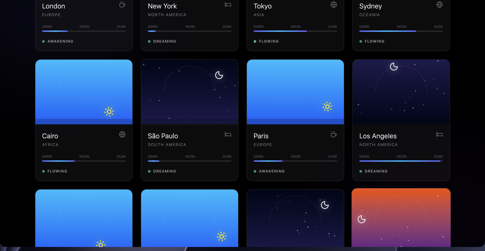

# Chronos — Visual Time



Time without numbers. Each card is a city, each sky is its current moment — dawn breaking over London, deep night in New York, noon blazing across Tokyo. The sun and moon orbit on dashed arcs, stars twinkle at night, and poetic labels like "Awakening" and "Dreaming" replace the digits.



## Quick Start

```bash
git clone https://github.com/yourusername/chronos-visual-time.git
cd chronos-visual-time
npm install
npm run dev
```

Opens at [http://localhost:3000](http://localhost:3000). No API keys, no env vars — it's pure client-side.

## How It Works

Click a continent filter to narrow the grid. Each city card computes its local time via `Intl.DateTimeFormat`, converts it to a fraction of the day (0–1), and renders:

- **Sky gradient** that shifts through 7 color states (deep night → dawn → morning → noon → afternoon → sunset → night)
- **Sun/moon** orbiting on a sine-wave arc with spring-physics positioning
- **Twinkling stars** during night hours (randomized opacity cycles)
- **Progress bar** from Dawn → Noon → Dusk
- **Activity state** — Awakening, Flowing, Zenith, Twilight, Dreaming

All animations update every second.





## Tech Stack

| Layer | Technology |
|---|---|
| Framework | React 19 |
| Build | Vite 6 |
| Styling | Tailwind CSS 4 |
| Animation | Motion (Framer Motion) |
| Icons | Lucide React |
| Language | TypeScript |

## Project Structure

```
src/
├── App.tsx        # All components: SkyVisualizer, CityCard, Pulse, App
├── constants.ts   # 20 cities with timezone + continent data
├── index.css      # Tailwind entry point
└── main.tsx       # React DOM entry
```

## License

[MIT](LICENSE)
